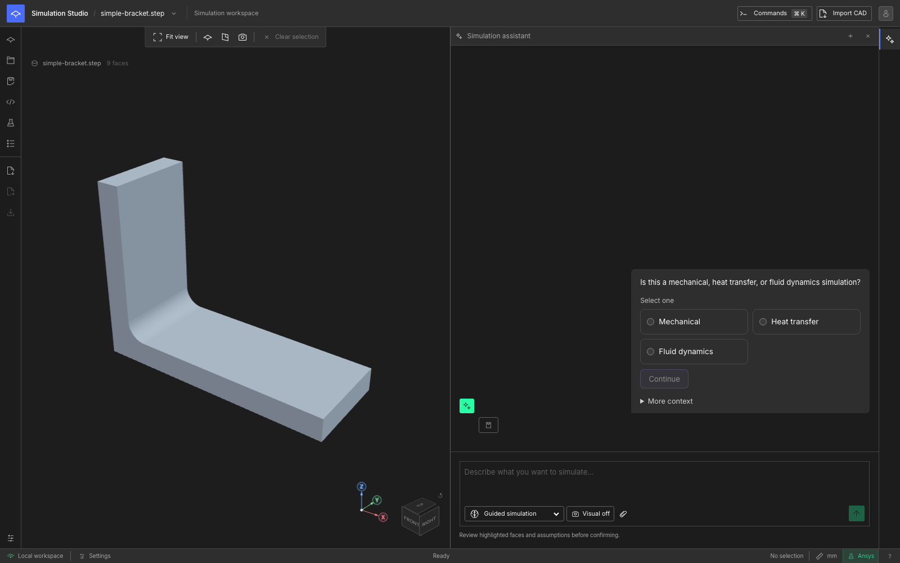
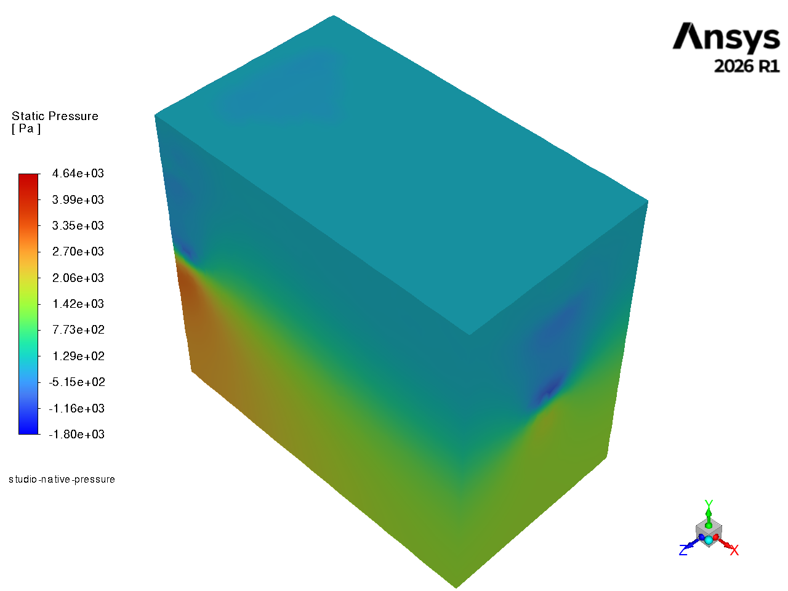

# Simulation Studio — prototype package

**Date:** November 15, 2026\
**Status:** working research prototype reconciled with the deployed Windows app\
**Source:** [`feat/simulation-studio-demo`](https://github.com/eandujar09/Project2-24679/tree/feat/simulation-studio-demo)\
**Live demo:** [Studio over Tailscale](http://100.88.230.43:7860/) (private access required)

This document is the starting point for inspecting the Project 2 prototype. The repository contains its source, demo CAD, analysis examples, dependencies, tests and recorded evidence.

## The prototype

Simulation Studio lets a user describe an analysis beside an interactive CAD model. The user can click an original face, ask a question or approve a proposal. The agent reads the same state and chooses among highlighting, proposing conditions, preparing fluid CAD, inspecting APIs and running generated solver code. Questions, explanations, plots and measured outputs return to the conversation.

*Live deployment, November 15. Importing the included bracket displays nine faces and asks which physics the user intends. Uploading creates an empty setup; opening a saved model can restore conditions.*

## Inspect the artifact

| Review item | Included material |
| --- | --- |
| Working interface | [Live app](http://100.88.230.43:7860/) and screenshot above |
| Implementation | [React UI](src/studio/), [agent/state](gradio_app/), [Mechanical](mechanical/), [Fluent](fluent/) |
| Data and demo | [Nine-face bracket STEP](examples/simple-bracket/simple-bracket.step), [dimensions](examples/simple-bracket/README.md), [walkthrough](docs/DEMO.md) |
| System explanation | [Agent/tool/state diagram](docs/ARCHITECTURE.md) |
| Checks | [Verification](docs/VERIFICATION.md), [test summary](docs/evidence/verification.json), [deployment hashes](docs/evidence/deployment-audit.json) |
| Measured outputs | [Mechanical reference](examples/simple-bracket/verified-demo.json), [Fluent report excerpt](docs/evidence/fluent-verified-run.json), images below |
| Reproduction | [Setup](docs/SETUP.md), [configuration examples](config/), [test commands](docs/VERIFICATION.md#repeat-the-checks) |
| Limits | [Supported scope and remaining work](docs/LIMITATIONS.md) |

## A short demonstration

1. Import `simple-bracket.step`, choose **Mechanical**, and use **Guided simulation**.
2. Describe a steel bracket rigidly attached at its broad outside back, with a 100 N downward tip force. Ask the agent to highlight and preview its choices.
3. Inspect the original faces and proposed graphics. Confirm or correct them in chat.
4. Ask for a linear static study. Review the generated Python and approve execution.
5. Read the solver status, plots and values. Refine the question, compare meshes, or export the setup/results.

The [full walkthrough](docs/DEMO.md) supplies prompts and recovery guidance. A completed Python process and a successful solve are distinct outcomes.

## Implemented capabilities

| Capability | Evidence and scope |
| --- | --- |
| Face-aware chat, previews and approval | Current Python/JavaScript/browser tests and live import inspection |
| Screenshot and pixel picking | Browser-tested; needs an open responding viewer and image-capable model |
| Generated Mechanical execution | Historical real bracket study; exact source/artifacts retained per job |
| Generated Fluent execution | Historical real steady-water case with 18 mapped faces and converged solve |
| Thermal setup | Five thermal condition types, units, graphics and persistence tested; no new thermal solve claimed |
| Fluid-domain preparation | Actual OpenCascade box/cylinder construction and subtraction tested |
| Native exports | Mechanical `.mechdat` / `.mechpz`; Fluent `.cas.h5` / `.dat.h5` in result ZIP |
| Native Fluent images | Optional isolated MCP renderer; real retrieved images below |

## Concrete verification evidence

### Software checks — November 15, 2026

The recovered deployed source passed **196 Python tests, 17 JavaScript tests and nine Studio browser tests**. Both frontend builds completed; their seven generated files matched the deployed frontend hashes byte for byte. An authenticated browser imported the supplied bracket and displayed its nine faces and physics-choice question.

These establish software/interface behavior, not Ansys numerical accuracy. Browser tests use a scripted agent and explicitly synthetic solver outputs; their domain-construction test uses real OpenCascade geometry. [Commands and evidence](docs/VERIFICATION.md).

### Mechanical reference study — November 5, 2026

The recorded bracket case uses Structural Steel, one fixed back face and a total 100 N global-negative-Z tip force.

| Mesh setting | Nodes | Elements | Maximum displacement, mm | Maximum equivalent stress, MPa |
| --- | ---: | ---: | ---: | ---: |
| 8 mm | 655 | 80 | 0.0502165 | 20.0510 |
| 5 mm | 2,024 | 318 | 0.0502465 | 23.4997 |
| 3 mm | 7,276 | 1,330 | 0.0503228 | 23.4936 |

The recorded 5-to-3 mm displacement change is **0.152%**. This is historical evidence retained in [the original record](examples/simple-bracket/verified-demo.json), not a new solve performed during packaging. It does not establish convergence at every stress concentration.

### Fluent result — November 12, read back November 15

The saved host-controlled water-flow run has **25,685 cells**, **18 geometrically mapped CAD faces**, and **929 iterations**. Recorded residual checks passed. Relative mass imbalance is **1.7737 × 10⁻⁷**, below the specified **0.001** threshold. Its archive reports successful native postprocessing without rerunning the solve.

*Native Fluent boundary-surface pressure from the saved converged run, not an internal slice or synthetic browser image.*

[Velocity view](docs/evidence/native-velocity.png) · [Measured excerpt](docs/evidence/fluent-verified-run.json) · [Run details](fluent/VERIFIED_WATER_RUN.md)

This verifies one worker case, not arbitrary CFD. The original run was host-controlled and was not attached as a new result to the then-open chat session. Numerical convergence does not establish steady-laminar physical suitability or mesh/domain independence. The private model database and complete run archive remain on the host; they are not copied into this package.

## Human decisions and limits

The user supplies physical intent: material, supports, load meaning/direction, fluid-domain role, boundaries and acceptance criteria. The agent may propose choices; Guided mode asks for approval of the specific change or exact code. User selection and agent highlights remain separate.

A major unresolved issue is whether a plausible, converged setup represents the intended real situation. Independent checks, benchmark coverage and mesh/domain studies are still needed. Automatic FSI, transient Fluent stepping, multi-region conjugate heat transfer and general custom-domain extraction are outside the current verified scope. [Full limits](docs/LIMITATIONS.md).

## Review and access

- **GitHub:** the repository is private. Grant reviewers access before sharing this branch-specific package link. Default `main` predates the demo.
- **Live app:** the host must be awake and running Studio; reviewers need authorized Tailscale access and the demo login separately. `127.0.0.1` refers to their own device, not the shared demo.
- **Without VPN/Ansys:** inspect this document, source, screenshots and outputs, download the bracket, and run unlicensed checks or the synthetic UI fixture in [Setup](docs/SETUP.md).
- **Offline:** a source archive of this branch contains the document, figures, code and examples. It excludes credentials, installed environments, Ansys and live CAD databases. Real solver runs need the documented external software and licenses.

## Artifact preparation

Codex assisted with source recovery, checks, evidence collection and technical documentation. The assignment's skill comparison, independent check and reflective brief are separate from this technical artifact.
