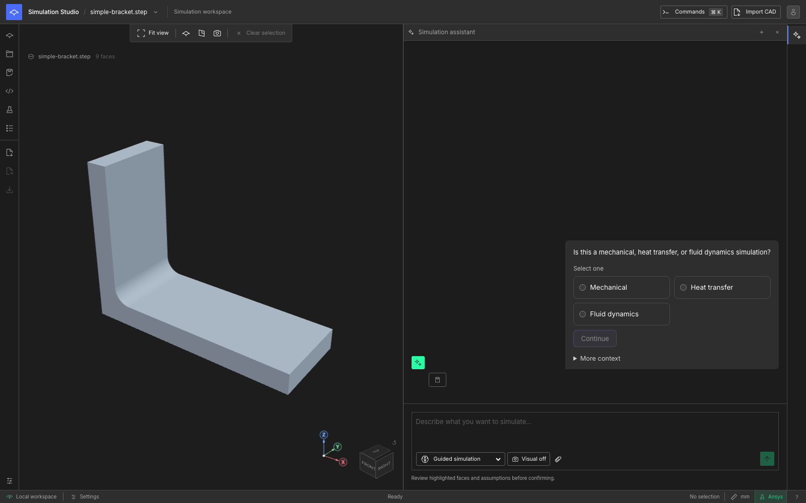

# Simulation Studio

**Upload STEP CAD, describe a simulation, review the agent's highlighted faces and proposed conditions, then run Ansys and inspect the results.** This is a working Project 2 prototype for conversational simulation setup, not a general CAD editor or an engineering certification tool.

**Start with the [Prototype package](PROTOTYPE_PACKAGE.md).** It is the shareable project artifact: current status, walkthrough, measured evidence, limitations, and links to the implementation and demo files.



*Captured from the authenticated Tailscale deployment on November 15, 2026. The imported bracket has nine faces and no pre-applied conditions.*

## Current version

| Item | Status |
| --- | --- |
| Review branch | [`feat/simulation-studio-demo`](https://github.com/eandujar09/Project2-24679/tree/feat/simulation-studio-demo) |
| Package date | November 15, 2026 |
| Live app | [Studio over Tailscale](http://100.88.230.43:7860/) — authorized VPN access and demo login required |
| Deployment verification | [Audit](docs/DEPLOYMENT.md) and [file hashes](docs/evidence/deployment-audit.json) |
| Checks | 196 Python tests, 17 JavaScript tests and nine Studio browser tests passed; both frontends build |
| Status | Working research prototype; Mechanical and Fluent execution, thermal annotations and fluid-domain preparation implemented |

The repository is private. Reviewers need GitHub access; the live app additionally requires Tailscale and the application login. Credentials and runtime CAD databases are excluded. The default `main` branch predates this demo: share the branch-specific [package link](https://github.com/eandujar09/Project2-24679/blob/feat/simulation-studio-demo/PROTOTYPE_PACKAGE.md).

## What it does

- Preserves identities for complete original CAD faces and maps viewport clicks to those faces.
- Shares selection, highlights, proposals, confirmed setup and results between viewer and agent.
- Previews support glyphs, force vectors and thermal/fluid conditions before Guided-mode approval.
- Lets the model choose tools, ask questions, generate analysis Python and respond to real errors/results.
- Runs PyMechanical or PyFluent in fresh, bounded jobs on the Windows Ansys host.
- Offers optional viewport screenshots and pixel-to-face picking independently of assistant mode.
- Constructs confirmed box/cylinder fluid domains with OpenCascade, including obstacle subtraction.
- Exports Mechanical setup/result files, Fluent case/data, and source/log/result archives.

Fluent is implemented in this version. Its checked execution handles steady flow in one fluid zone. Automatic fluid–structure coupling, multi-region conjugate heat transfer, transient Fluent stepping and general custom-domain extraction remain outside the verified scope.

## Try it

1. Open the hosted app, or follow [Setup](docs/SETUP.md).
2. Import [simple-bracket.step](examples/simple-bracket/simple-bracket.step).
3. Choose **Mechanical** and keep **Guided simulation** selected.
4. Follow the [demo walkthrough](docs/DEMO.md), reviewing faces, conditions and code before confirming.
5. Inspect measured outputs, plots, generated Python and exports.

For a configured Mac checkout with Python 3.12 and Node.js installed:

```sh
./scripts/setup-mac.sh
.venv-gradio/bin/python scripts/run_mac.py
```

Open `http://127.0.0.1:7860/` on that Mac. The OpenCode/model connection and licensed Ansys environments are separate prerequisites. `npm run dev` starts the older annotation-only viewer, not the chatbot application.

## Documentation

| Document | Purpose |
| --- | --- |
| [Prototype package](PROTOTYPE_PACKAGE.md) | Single starting document for review |
| [Demo guide](docs/DEMO.md) | CAD, prompts, expected behavior, exports and recovery |
| [Setup](docs/SETUP.md) | Reproduce environments and configure private connections |
| [Architecture and tools](docs/ARCHITECTURE.md) | Agent loop, state, tool branches and solver boundaries |
| [Verification](docs/VERIFICATION.md) | Fresh tests versus historical live-solver evidence |
| [Deployment audit](docs/DEPLOYMENT.md) | Reconciliation with the running host |
| [Limits and next work](docs/LIMITATIONS.md) | Supported scope and failure behavior |
| [Chat/MCP reference](gradio_app/README.md) | Resources, state and Mechanical execution |
| [Fluent runtime](fluent/README.md) | Authored-code contract, mapping and convergence |
| [Thermal and fluid domains](HEAT_TRANSFER_AND_DOMAINS.md) | Units, geometry preparation and choice cards |
| [Fluent API discovery](FLUENT_MCP.md) | Official MCP inspection, separate from execution |
| [Optional native renderer](integrations/fluent_post/README.md) | Isolated postprocessing adapter and dependency |
| [Windows hosting](VM_HOSTING.md) / [Mac transport](MAC_REMOTE_SETUP.md) | Operational details |
| [Legacy viewer](docs/LEGACY_VIEWER.md) / [preset solver](mechanical/README.md) | Earlier entry points |

## Source map

```text
src/studio/           React application and chat/viewport layout
src/viewer/           Three.js picking, highlights and condition graphics
gradio_app/           CAD processing, workspace, chat, HTTP and MCP
mechanical/          PyMechanical runtime, mapping, transport and recovery
fluent/              PyFluent runtime, mapping, inspections and results
integrations/        Optional native Fluent graphics adapter
scripts/             Setup, launch, deployment and worker entry points
examples/            Original bracket CAD and analysis examples
tests/               Python, JavaScript, browser and licensed tests
docs/                Review documentation and recorded evidence
```

## Attribution and AI assistance

The frontend adapts MIT-licensed components, tokens and icons from [Zoo Design Studio](https://github.com/KittyCAD/modeling-app), pinned to `d01b321d5540cbcc59d8d7941cfb6056bbe1c91b`. [Provenance](src/studio/vendor/zoo/PROVENANCE.json), the [MIT notice](src/studio/vendor/zoo/LICENSE) and [Inter license](src/studio/vendor/zoo/fonts/LICENSE.txt) are retained. Zoo's CAD engine and editing state machines are not integrated.

Codex assisted with implementation, tests, deployment reconciliation and technical documentation. The in-app model generates analysis code; exact executed source is retained in job artifacts. This package documents the technical artifact; it does not replace independently written coursework.
