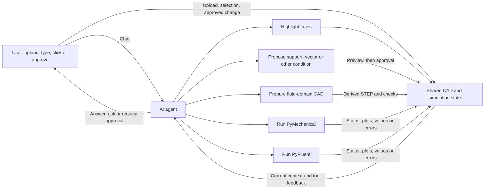

# Agent, tools and shared state

The ReAct-style loop is: read message/state, choose a tool or reply, observe feedback, then decide again. Highlighting does not require a simulation. A proposal changes the preview; approval applies its saved setup change.

The branches are alternative choices. Both solvers are implemented in this package; automatic coupling remains future work.

## What the agent gets

[geometry.py](../gradio_app/geometry.py) uses OpenCascade to import STEP, identify original faces and extract surface descriptors, areas, centroids, bounds and sampled trim/surface geometry. Viewer triangles retain original-face mappings. CAD hashes identify exact input bytes; each fresh import gets an independent setup.

Context includes the current model/revision, selected face, separate assistant highlights, confirmed conditions, simulation intent, fluid-domain definition, analysis settings and run status. Shape metadata describes observed geometry; it does not reveal the real function or correct physical use of a face.

Visual assistance additionally supplies viewport images and frozen-camera pixel-to-face picking. It does not control the desktop or alter the user's selection. The model request contains fresh state, conversation, runtime guidance and bounded observations. Full source/logs/tables remain in artifacts. See [chat_agent.py](../gradio_app/chat_agent.py), [chat_context.py](../gradio_app/chat_context.py) and [chat_state.py](../gradio_app/chat_state.py).

## Tool map

| Group | Tools | Effect |
| --- | --- | --- |
| Display/inspect | `highlight_faces`, `capture_viewport`, `pick_viewport_face` | Inspect/highlight without applying a condition |
| Intent/settings | `set_simulation_intent`, `set_analysis`, `set_fluent_analysis` | Record agreed scope/settings; preset fields are not universal code defaults |
| Conditions/notes | `apply_condition`, `remove_condition`, `add_comment` | Guided approval precedes saved changes |
| Fluid CAD | `suggest_fluid_domain`, `set_fluid_domain`, `create_fluid_domain` | Suggest/confirm dimensions, then construct a separate derived model |
| Mechanical | `run_mechanical_code`, `recover_mechanical_run` | Execute exact code or recover the same job; `run_simulation` is the older preset |
| Fluent | `run_fluent_code`, `recover_fluent_run` | Authored meshing, physics, solving and exports |
| API inspection | `find_fluent_api`, `get_fluent_api_help`, `validate_fluent_api_code` | Official read-only MCP discovery/validation; no solver launch |
| Workflow checks | `validate_fluent_program`, `check_fluent_worker`, `review_fluent_workflow` | Local contract/package checks and reference guidance |
| Native graphics | `render_fluent_results` | Optional images from an existing verified converged result; no new solve |

[Typed schemas](../gradio_app/chat_tools.py) are authoritative. A "propose vector" interaction is guarded `apply_condition` plus preview graphics, not a literal `propose_vector` API.

## Approval

`ChatWorkspace` owns state; `ChatAgent` proposes actions. Guided mode binds a pending proposal to its relevant state fingerprint and exact confirmation token. Changed selection/setup, stale tokens, corrections and foreign-model choices cannot approve an earlier change. A click is not approval. Corrected code requires a new approval.

Autonomous mode removes per-action approval pauses but retains source validation, identity, mapping, resource caps and recovery rules. Visual assistance is independent. External authenticated MCP clients are trusted controllers and must implement their own confirmation flow.

## MCP and execution

Studio exposes shared resources and typed tools at `/mcp/`. The built-in chat reads the same state and invokes the same tool implementation directly; each step is not a separate MCP network call. Resources are read on demand, without change subscriptions.

The official Fluent MCP server provides isolated API discovery/help/validation. Actual Mechanical/Fluent jobs use direct worker execution. Optional `fluent-post` MCP provides native visualization of existing case/data after a verified solve. These are three distinct roles.

## Data flow and persistence

1. Browser uploads STEP to Studio; Python owns geometry and storage.
2. OpenCode's configured model receives conversation/context and optional viewport images, without provider credentials in the prompt.
3. Authenticated file/shell APIs send geometry, inputs and code to the Windows worker. Tailscale provides reachability; OpenCode provides API authentication. SSH is optional and unused here.
4. A fresh job validates identity, maps faces and executes bounded code. Source, reports, logs and native files are retained.
5. Results feed the next agent step. Uncertain submissions are recovered by identity, not automatically repeated.

Studio and the worker currently share a Windows host; a Mac development setup runs Studio locally and sends remote model/solver calls. Saved CAD/setup/job files persist in `gradio-data/`; conversations and pending proposals are in memory. New conversation preserves saved conditions, while fresh import creates an empty setup. See the [MCP/persistence reference](../gradio_app/README.md).
